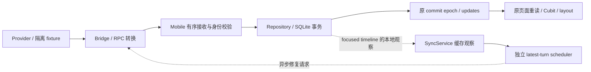

# 当前接收链路地图

地图固定到起始 SHA；后续修改由账本说明。它描述源码调用关系，不能单凭存在调用就声称运行通畅。

| 段 | owning path | 输入/输出与权威 | 需要证明的完成条件 |
|---|---|---|---|
| Provider | Codex app-server/history；Claude 原始记录 | 原始 Thread/Turn/Item、状态与内容 | 原始事实可读取；完成事件不是完整历史的替代 |
| Bridge Provider 转换 | codex-process.ts / local-features/codex-thread-history.ts | 原始 DTO → normalized 稳定身份、顺序、内容 | 不用正文/时间/位置造身份；工具与所属轮次正确 |
| Bridge 同步 | local-features/conversation-sync-v2.ts | 订阅/快照/patch/分页/Gap；带 source、subscription、sequence | 合法帧有界，partial 诚实，恢复与回补有终态 |
| Mobile 接收 | services/bridge_service.dart；models/local_features/slots/conversation_sync_v2_protocol_slot.dart | WebSocket JSON → 类型事件；错误分类和诊断 | 合法输入不误拒绝，非法输入明确拒绝，解析失败不静默消失 |
| Mobile 入站顺序 | features/conversation_content_sync/conversation_content_sync_service.dart | 校验 identity/generation/subscription，再串行提交 | 旧源/旧代响应不生效；序列洞转恢复；事务后 ACK |
| SQLite | features/session_list/cache/session_catalog_cache_repository.dart | staging → hot window；受 revision/identity/预算约束 | 原子提交；partial 保留 last-good；完整性不误报 |
| 缓存通知 | SyncService._publishCacheUpdate / syncUpdates | 本地 commit epoch 与数据变化事件 | 有效内容/coverage 变化可被观察；不改 Provider revision |
| 页面重读 | codex_session_screen.dart._loadDurablePreview | 订阅 updates → durable window → 页面/Cubit | 新内容到达页面；旧异步读不能回退已更新画面 |
| 展示投影 | chat_session_cubit.dart / chat_process_layout.dart | committed 内容与独立 live overlay | 稳定顺序、无重复、工具归属正确、partial 不清空可读内容 |

## 不同状态不能互相替代

| 状态 | 证明的事实 | 不能据此声称 |
|---|---|---|
| frame received / decoded | 传输/解析完成 | 已提交、已展示、全量完整 |
| committed sequence | 该事件已处理/事务结束 | 该会话最新轮次已完整 |
| canonical revision | 历史基线/lineage | 所有后续 partial 内容都相同 |
| cache commit epoch | 本地观察者应重新读取 | Provider 历史发生了同名版本变化 |
| loaded | 一次请求得到并接受内容 | 缺口已填完或无需后续修复 |
| latestTurnComplete / windowComplete | 对应覆盖范围的声明 | 数据是否改变、是否应该通知 |
| runtime overlay | 已验证的临时展示事实 | 可取代 durable canonical history |

## 第一批已确认的接缝

- turns_page 修复在 Repository 保留 latest_turn_complete=0；Service 用该值决定是否通知。
- 自动 turns_page 修复以 canonical revision 记住成功，而合法 partial 内容可能继续使用该 revision。
- Service 已有 Gateway、Repository、通知出口；先修 owning path，无需新造刷新系统。
- 自动修复状态、计时器、去重记录集中，但 focus/source/transport/reset/dispose 接点分散，
  抽取时必须把这些接点一并列入回归。

## 仍需单独验证

真实 Provider 的新消息到达、长会话/工具密集、fork/同名隔离、旧 Bridge 降级、
后台恢复、发送/steer/approval、实际设备与生产运行均不能仅由本批短闭环测试覆盖。

## B1 后的自动修复边界

SyncService 从 committed cache 构造 LatestTurnRepairRequest；
LatestTurnRepairScheduler 独占自动去重/dirty/operation token/失败状态与 retry timer。
三个回调只分别判断当前身份、执行 Service 原修复、重新观察缓存；
请求与 SQLite 写入、coverage、通知、页面仍使用上表的原路径。
取消接点与失败预算见 RUNBOOK，验证收据见 PROCESS。

focused timeline 的观察在同一接收序列内先完成，后来的 repair reply 才能继续提交；
观察只等本地读取与排队，不等待图中返回 Bridge 的网络请求。
repair transaction 接受后仍走原通知出口；图不表示所有事务都自动启动 repair。

## 限制的对象与归属

本表列本批涉及并在源码中核对的限制，不是全项目常量总表。
后续增加或调整限制时，应补对象、owner、可见失败与矩阵入口，不能只在多处加判断。

| 限制 | 约束的对象 / 现有 owner | 修改时需要核对 |
|---|---|---|
| 64 KiB | Bridge conversation-sync-v2 的编码帧字节数 | 合法帧组合、分片/partial、R09；不是条目数量 |
| 64 entries | Mobile protocol_slot 的单页新增内容 | 解码边界、R06；不是删除数量 |
| 2000 delete IDs | 同 protocol_slot 的单页删除身份 | 64/2000/2001 回归、R06；组合帧仍有字节上限 |
| 2000 rows | Repository.maxHotWindowEntries 的本地热窗口 | 保留前缀、覆盖声明、分页/rollover、R07/R11；不是渲染数量 |
| 4 次失败 / 1、2、4 秒重试 | scheduler 每个 revision/turn/repair 操作 | 失败预算与取消、R15；不是手动操作 deadline |
| 128 个完成观察 | scheduler 的 summary observation 记忆 | 去重与新进度、R02/R03；不是 Provider revision |

相同数值可能约束不同对象。先确认对象和权威出口，再判断是否能合并或退役；
本批没有为减少判断数而放宽身份、coverage 或容量保护。
