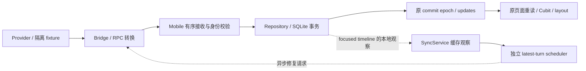

# 当前接收链路地图

起始链路与各批新增责任由下表及 B1/B2/C1a/C1b 章节说明，当前验证身份见 PROCESS。
它描述源码调用关系，不能单凭存在调用就声称运行通畅。

| 段 | owning path | 输入/输出与权威 | 需要证明的完成条件 |
|---|---|---|---|
| Provider | Codex app-server/history；Claude 原始记录 | 原始 Thread/Turn/Item、状态与内容 | 原始事实可读取；完成事件不是完整历史的替代 |
| Bridge Provider 转换 | codex-process.ts / local-features/codex-thread-history.ts | 原始 DTO → normalized 稳定身份、顺序、内容 | 不用正文/时间/位置造身份；工具与所属轮次正确 |
| Bridge 同步 | local-features/conversation-sync-v2.ts | 订阅/快照/patch/分页/Gap；带 source、subscription、sequence | 合法帧有界，partial 诚实，恢复与回补有终态 |
| Mobile 接收 | services/bridge_service.dart；models/local_features/slots/conversation_sync_v2_protocol_slot.dart | WebSocket JSON → 类型事件；错误分类和诊断 | 合法输入不误拒绝，非法输入明确拒绝，解析失败不静默消失 |
| 订阅焦点意图 | SyncService._rememberSubscriptionFocusAtSend / _reconcileSubscriptionFocus / _sendFocusedConversation | 实际 subscribe 焦点快照 → 当前匹配接受时最新焦点；V1/V2 原消息 | 快照与 payload 一致；不同才补发；旧接受/来源/dispose 不消费新意图；失败不继续 bootstrap/ACK |
| Mobile 入站顺序 | features/conversation_content_sync/conversation_content_sync_service.dart | 校验 identity/generation/subscription，再串行提交 | 旧源/旧代响应不生效；序列洞转恢复；事务后 ACK |
| SQLite | features/session_list/cache/session_catalog_cache_repository.dart | staging → hot window；受 revision/identity/预算约束 | 原子提交；partial 保留 last-good；完整性不误报 |
| 缓存通知 | SyncService._publishCacheUpdate / syncUpdates | 本地 commit epoch 与数据变化事件 | 有效内容/coverage 变化可被观察；不改 Provider revision |
| 页面重读 | codex_session_screen.dart._loadDurablePreview / durable_preview_read_lifecycle.dart | 原 updates/SQL window；helper 只拥有 ticket/dirty/失效 | 新内容到达页面；旧读/错误/finally 不影响新目标；受阻补读可恢复 |
| 历史准备与接受 | handler.prepareHistory / prepareDetachedCanonicalHistory / 原 Cubit | 无副作用解码与不可变 canonical 候选；拒绝保留 last-good | duplicate 拒绝先于设置/审批/queue/paging；receipt 仅来自原 canonical |
| 展示投影与后置确认 | candidate.compose / 原 Cubit / handler.commitPreparedHistory / layout | 当前合法 overlay 与已接受 canonical；提示在实际应用后确认 | 无重复、工具归属正确；拒绝不消费提示/receipt/alias |
| runtime item 完成 | Bridge.sessionMessage → focused runtime_overlay → Service → Cubit 原 streaming handler | 独立 source/runtime/authority/turn 与 item 事实；不写 SQL | 对应 transient 关闭；R35 pending-focus 交错 PASS，其他交错/R29 各自证明 |

## 不同状态不能互相替代

| 状态 | 证明的事实 | 不能据此声称 |
|---|---|---|
| frame received / decoded | 传输/解析完成 | 已提交、已展示、全量完整 |
| committed sequence | 该事件已处理/事务结束 | 该会话最新轮次已完整 |
| canonical revision | 历史基线/lineage | 所有后续 partial 内容都相同 |
| cache commit epoch | 本地观察者应重新读取 | Provider 历史发生了同名版本变化 |
| loaded | 一次请求得到并接受内容 | 缺口已填完或无需后续修复 |
| latestTurnComplete / windowComplete | 对应覆盖范围的声明 | 数据是否改变、是否应该通知 |
| runtime overlay | 已验证的临时展示事实 | 可取代 durable canonical history |

## 第一批已确认的接缝

- turns_page 修复在 Repository 保留 latest_turn_complete=0；Service 用该值决定是否通知。
- 自动 turns_page 修复以 canonical revision 记住成功，而合法 partial 内容可能继续使用该 revision。
- Service 已有 Gateway、Repository、通知出口；先修 owning path，无需新造刷新系统。
- 自动修复状态、计时器、去重记录集中，但 focus/source/transport/reset/dispose 接点分散，
  抽取时必须把这些接点一并列入回归。

## 仍需单独验证

真实 Provider 的新消息到达、长会话/工具密集、fork/同名隔离、旧 Bridge 降级、
后台恢复、发送/steer/approval、实际设备与生产运行均不能仅由本批短闭环测试覆盖。

## B1 后的自动修复边界

SyncService 从 committed cache 构造 LatestTurnRepairRequest；
LatestTurnRepairScheduler 独占自动去重/dirty/operation token/失败状态与 retry timer。
三个回调只分别判断当前身份、执行 Service 原修复、重新观察缓存；
请求与 SQLite 写入、coverage、通知、页面仍使用上表的原路径。
取消接点与失败预算见 RUNBOOK，验证收据见 PROCESS。

## B2 后的 older-turn 分页边界

Service 的 `loadOlderTurns` 向 `OlderTurnsPagingLifecycle` 取得一个 target/provider/session flight。
模块独占 single-flight、准备/排队 operation、wire pending、15 秒 deadline、恰好一次结算和取消。
Service 保留 `_enqueueHistoryOperation` 与 latest repair 的共享串行，以及订阅替换的
最多两次尝试/8 秒等待。结果 DTO 独立保存，原 Service export 维持调用方入口。

wire 回复只有通过原 source/subscription/sequence/request 身份核对，才调用 Repository 的
revision/cursor 原子 prepend。重复 non-null cursor 在写入前拒绝。
thread reset 同时失效准备、排队和已发送请求；其他 thread/source 不受影响。

已进入本地 mutation 后，提交事实的观察者通知按当前 cache partition 且未 dispose 判断；
成功/可能已提交但 snapshot read 出错都使用原 epoch/updates。同源订阅替换不能隐藏本地事实。
旧 generation 的 syncUpdates/ACK 仍被原 transport fence 拦截。
取消后已开始的本地工作保留 join 责任，不能提前关闭 SQLite 或把异常等同 rollback。
跨 source / dispose 不通知旧目标，未来新请求取得独立 operation 身份。

本批真实 older-pages 黑盒通过生产页面自动 loader 请求两页，验证原页面更新、稳定 ID/顺序、
cursor 1→2→null、最新内容保留与加载终态；上游仍为隔离 Provider fixture。
具体终态与测试入口见 PAGING-LIFECYCLE / TEST-MATRIX。

## C1a 后的页面读取边界

`DurablePreviewReadLifecycle` 独占当前 ticket、loading target、dirty 合并与 invalidate/dispose。
ticket 保存原 Service 的 target/thread/cache epoch；以操作对象身份核对 owner，不生成 Provider revision。
页面继续获取 SQL window 和当前来源；success/error 共用接受判定，setState、last-good、cachedAt、
Snackbar/Retry 与 Cubit 更新仍留在页面。旧 finally 只能退休自己的 ticket。

dirty 在 follow-up 暂因 source conflict 不能开始时保留；真正 begin 或显式 invalidate 才消费。
重新认证同来源时检查 `needsRead`，不能用“该分区已经显示过”跳过已提交内容。
被动权威 session list 的 runtime 绑定保留 durable reader；它的 receipt/control/overlay 路径
不具有 canonical history 写权，不能机械套用显式 attachment 的失效规则。

真实 SQL/页面与生命周期保护见 R23–R28；原 Bridge/RPC 黑盒仍经同一 Service/Repository/页面。
shared legacy/paged mirror 的 weaving 算法另有调用边界，C1b 没有统一替换它们。

## C1b 后的 canonical 接受边界

原 handler 的 `prepareHistory` 只解码；`prepareDetachedCanonicalHistory` 在原投影模块
冻结 canonical 输入，准备 alias 索引、duplicate 判定和原输入的 client receipt 证据。
duplicate 候选在原 Cubit 的 public durable history 入口整体拒绝，设置/审批/queue/paging 不先应用。
合法候选进入原 `_applyUpdate`，由原 owner 先筛选当前 overlays，再以工作副本 `compose`；
应用后消费对应 receipt/alias，并确认历史 Git tip。overlay enrich 的 client ID 不生成 canonical receipt。

普通 handler History/live 与 `projectDetachedTimeline` API 保持入口兼容；
SQLite、通知、C1a reader 与 shared weaving 仍属于原 owner。
canonical admission 的保护与最终源码门禁见 R30–R34 / E041。
R35 是另一条 runtime 完成信号路径：发送后、接受前的焦点变化只留在本地，Bridge 实际订阅无焦点，
canonical A/B 可以正确落库但缺少 runtime_overlay，仍合并进 transient。
Service 保存一份带 generation/request/target/Bridge/source/协议的实际发送快照；
匹配 V1 subscribed / V2 syncBegin 后、首次 await 前只补发不同的最新焦点（含 null）。
快照在接受或原失效出口退休，不是第二套调度器，也不拥有数据库、canonical 或页面状态。
Bridge 焦点/authority fence 保持原规则。十七项契约与原页面旧 red / 新 green 见 R35/R36。
R29 旧失败的 subscribe 已有焦点，wire 有 A/B/final 三个完成事件；不能套用 R35 根因，
后续接受与折叠判断的缺口见 [R29-FOLD-ENTRY](R29-FOLD-ENTRY.md)。

## C1c/C1d 的终态与隔离队列边界

StreamingStateCubit唯一持有inputRevision，append接受时即推进，包含未发布text/thinking；reset也推进。
原Cubit在tagged socket idle且经过external Desktop guard后记录generation/source/revision ticket。
新增terminal清理还必须满足当前source/binding lease及status的bridgeRuntime、authoritative、
bridge host、loaded、远端runtimeSessionId精确匹配；ticket未被后续增量/reset/重绑改变。
普通idle只提供顺序证据；status中的runtime ID来自Bridge snapshot.bridgeSessionId，
appServer/失效转换剥离旧ID，JSON/SQL保存它；它本身不构成控制授权。
过滤runtime rows在清visual assistant alias前发生，runtime completion不取得canonical写权。

RuntimeOverlayQuarantine独占pending map与bytes，最大32个event/64KiB编码消息；
超限拒绝新事件，duplicate不改预算，remove/clear一起退休bytes。
原Cubit继续唯一负责admission、编码预算、apply和source/runtime/authority失效。
同binding/authority的turn退出只退休visible tracking；保留的pending随后由原flush逐项匹配或按时间拒绝。
authority mismatch清理要求已有visible tracking；queue-only不匹配且未证明旧的event仍隔离，策略见R47。
visual pending的256/257策略仍在原Cubit，尚未审定，不借quarantine合同宣称正确。
完整门禁与独立复核见E059/E060；保护、失败与未知边界见R37–R48及两份runtime入口。
原mutation lease用本地generation/source接纳authority，尚未在新terminal身份修复中验证；R48单列。

focused timeline 的观察在同一接收序列内先完成，后来的 repair reply 才能继续提交；
观察只等本地读取与排队，不等待图中返回 Bridge 的网络请求。
repair transaction 接受后仍走原通知出口；图不表示所有事务都自动启动 repair。

## 限制的对象与归属

本表列本批涉及并在源码中核对的限制，不是全项目常量总表。
后续增加或调整限制时，应补对象、owner、可见失败与矩阵入口，不能只在多处加判断。

| 限制 | 约束的对象 / 现有 owner | 修改时需要核对 |
|---|---|---|
| 64 KiB | Bridge conversation-sync-v2 的编码帧字节数 | 合法帧组合、分片/partial、R09；不是条目数量 |
| 64 entries | Mobile protocol_slot 的单页新增内容 | 解码边界、R06；不是删除数量 |
| 2000 delete IDs | 同 protocol_slot 的单页删除身份 | 64/2000/2001 回归、R06；组合帧仍有字节上限 |
| 2000 rows | Repository.maxHotWindowEntries 的本地热窗口 | 保留前缀、覆盖声明、分页/rollover、R07/R11；不是渲染数量 |
| 4 次失败 / 1、2、4 秒重试 | scheduler 每个 revision/turn/repair 操作 | 失败预算与取消、R15；不是手动操作 deadline |
| 128 个完成观察 | scheduler 的 summary observation 记忆 | 去重与新进度、R02/R03；不是 Provider revision |
| 15 秒响应 deadline | older lifecycle 已登记的单次 wire request | deadline/终态与迟到 reply，R18；不是 SQLite 事务强行回滚期限 |
| 两次尝试 / 8 秒等待 | SyncService older 订阅替换恢复 | 只对 paging interruption 重试，R07/R08/R17；thread reset/error 不绕过预算 |
| 32 events / 64KiB | RuntimeOverlayQuarantine的尚未验证authority/turn消息 | FIFO/拒绝新超限/bytes退休，R43/R44；不是已呈现条目的裁剪 |
| 256 messages | 原Cubit的visual turn validation pending | 256/257溢出策略尚NOT_RUN，R45；本轮不迁移 |
| limit 1–20 | older summary turns request | 分页 cursor 前进与数据范围，R17/R19；不等于 Mobile frame entries limit |

相同数值可能约束不同对象。先确认对象和权威出口，再判断是否能合并或退役；
本批没有为减少判断数而放宽身份、coverage 或容量保护。
